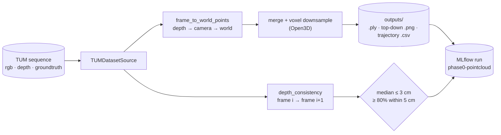
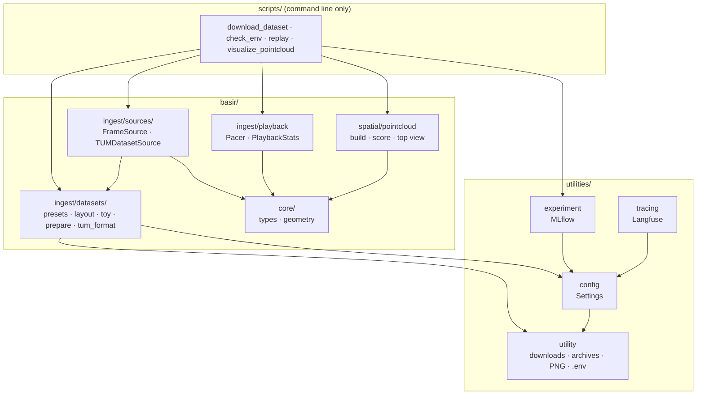

# Basir

<p align="center">
  <picture>
    <source media="(prefers-color-scheme: dark)" srcset="logo/basir-logo-dark.svg">
    
  </picture>
</p>

<p align="center">
  <picture>
    <source media="(prefers-color-scheme: dark)" srcset="logo/basir-readme-dark.svg">
    
  </picture>
</p>

<div align="center">

[](https://www.linkedin.com/in/omarrbakr/)
[](mailto:bakro0298@gmail.com)
[](https://leetcode.com/u/omar_bakr/)
[](https://omartbakr.github.io/)

</div>

> **Basir** (بصير, "the one who sees): a camera that remembers where it saw your things and walks you back to them.

**▶ [See the end-to-end flow](https://github.com/omarTBakr/Basir/blob/software_engineering/software_engineering/3_sequence_diagrams/system_overview.png)** (remember → ask → directions → found it) · [Jump to the Phase 0 check](#phase-0-check)

Basir watches a moving camera and builds a **spatial memory** of the objects it sees. Ask *"Where is my water bottle?"* and it finds the bottle in memory, even if it was seen minutes ago and is nowhere in view now. It answers with directions from where you stand ("turn right ~120°, go about 2.3 m, it's on the desk, last seen 45 s ago"), updates them as you move, and outlines the object on screen once it's back in view.

The deployment is a **phone + laptop** split. An Android phone running **ARCore** (realme 14 / 15) records video, its own 6-DoF pose and depth, and shows the answers. The laptop (RTX 4060, 8 GB) is the server that runs the models. No model is trained from scratch: detection, segmentation, embeddings and depth all come from pretrained models (Grounding DINO / YOLO-World, SAM 2/3, SigLIP 2, Depth Anything). The new work is the memory, the 3D fusion and the guidance.

The stage built today is **Phase 0, the foundation**: replay a recorded RGB-D scene, turn depth and camera poses into a correct 3D point cloud, and *measure* that it's correct. Every direction Basir gives later depends on this geometry. The later phases are fully designed but not built yet. The phases are summarised in the [Roadmap](#roadmap), and the UML (user stories, use cases, sequence and class diagrams) is in [`software_engineering` branch](https://github.com/omarTBakr/Basir/blob/software_engineering/software_engineering/README.md).

- [Phase 0 check](#phase-0-check)
- [Quickstart](#quickstart)
- [Configuration](#configuration)
- [Data versioning (DVC)](#data-versioning-dvc)
- [Features](#features)
- [Roadmap](#roadmap)
- [Architecture](#architecture)
- [Observability](#observability)
- [Tests](#tests)
- [Project structure](#project-structure)
- [License](#license)

## Phase 0 check

Phase 0 is done when a real recorded room comes out as **one clean point cloud**, and the numbers agree with what you see. The check runs on the [TUM RGB-D benchmark](https://cvg.cit.tum.de/data/datasets/rgbd-dataset), which has ground-truth camera poses from a motion-capture system. If the cloud looks wrong, the bug is in Basir's geometry, not in the tracking.

One `visualize_pointcloud.py` run does the following, as defined in [`scripts/visualize_pointcloud.py`](scripts/visualize_pointcloud.py):

1. **Load.** [`TUMDatasetSource`](basir/ingest/sources/tum.py) reads every Nth frame: RGB, depth in metres and the pose `T_world_cam`. The camera intrinsics come from the dataset's own calibration (freiburg1 / 2 / 3), not a generic default.
2. **Lift to 3D.** [`frame_to_world_points`](basir/core/geometry.py) back-projects each depth pixel and moves it into the world frame with the frame's pose.
3. **Fuse.** [`build_cloud`](basir/spatial/pointcloud.py) merges all frames into one coloured cloud, voxel-downsampled with Open3D.
4. **Score.** [`depth_consistency`](basir/core/geometry.py), averaged over frame pairs by [`average_consistency`](basir/spatial/pointcloud.py), projects each frame's surfaces into the next frame and compares them against that frame's own depth. Correct geometry leaves only sensor noise of a few cm; a pose or axis bug shows up as tens of cm, before you even look at the cloud.
5. **Save and log.** It writes `outputs/<dataset>.ply`, a top-down image and the camera trajectory, and logs params, metrics and those files to **MLflow**.



**Pass criteria:** the cloud of `fr1/room` shows walls, desk and floor sharp, with no doubled or ghost surfaces, and the red trajectory follows the walk. On the numbers side, the median consistency residual is **≤ 3 cm** and **≥ 80 %** of points are within 5 cm.

## Quickstart

```bash
uv sync                                                # everything, incl. torch with CUDA (several GB)
cp .env.example .env                                   # then adjust (see Configuration)
uv run python scripts/check_env.py                     # versions, CUDA check, resolved paths

uv run python scripts/download_dataset.py fr1/desk     # 328 MB
uv run python scripts/download_dataset.py fr1/room     # 746 MB
# or, on this machine: uv run dvc pull                 # restore both from the DVC remote

uv run python scripts/replay.py fr1/desk               # RGB + depth at real-time speed
uv run python scripts/visualize_pointcloud.py fr1/room # the Phase 0 check
uv run mlflow ui --backend-store-uri "sqlite:///$(pwd)/mlflow.db"   # browse the runs

# variants
uv run python scripts/download_dataset.py --list-presets                  # every TUM sequence
uv run python scripts/replay.py fr1/desk --speed 2                        # 2x; 0 = as fast as possible
uv run python scripts/visualize_pointcloud.py fr1/desk --every 10 --voxel 0.01
uv run python scripts/visualize_pointcloud.py fr1/room --no-window        # save files only, no viewer
uv run python scripts/check_env.py --langfuse                             # send one smoke trace
```

Notes:

- **Prerequisites:** Linux, [uv](https://docs.astral.sh/uv/) (it installs Python 3.12) and an NVIDIA GPU with a recent driver. Developed on an RTX 4060 Laptop (8 GB).
- **Replay keys:** space pauses, `q` or Esc quits.
- **Datasets are big and git-ignored.** They go to `datasets/` (or `$DATA_DIR/datasets`), with the archives in `datasets/_archives/`. An interrupted download resumes on the next run and is never mistaken for a finished one.
- **The two Phase 0 sequences are versioned with DVC.** `uv run dvc pull` restores the exact versions from the local DVC remote instead of downloading them again (see [Data versioning](#data-versioning-dvc)).
- **A preset that isn't downloaded yet** makes `replay.py` and `visualize_pointcloud.py` stop with the exact download command to run.
- **The toy dataset** (`download_dataset.py --create-toy-dataset --name toy_room`) is a tiny synthetic TUM-format scene used by the tests. It's handy for trying the scripts offline.

## Configuration

**Environment (`.env`):** every key is defined in [`utilities/config.py`](utilities/config.py). Real environment variables override the file, and `BASIR_<NAME>` overrides `<NAME>`, so generic names like `DEVICE` can be pinned. Only what the built phases use is configurable; each later phase adds its own settings.

| Setting | Does what |
|---|---|
| `APP_ENV` | `development`, `staging` or `production`; also tags Langfuse traces |
| `DEVICE` | `auto`, `cuda`, `cpu` or `mps`; `auto` picks CUDA when available |
| `DATA_DIR` | Root for `datasets/`, `outputs/`, `mlflow.db` and `mlartifacts/` (default: the project folder) |
| `MLFLOW_TRACKING_URI` | Where runs are recorded (default: `sqlite:///<DATA_DIR>/mlflow.db`) |
| `LANGFUSE_PUBLIC_KEY`, `LANGFUSE_SECRET_KEY`, `LANGFUSE_BASE_URL` | Runtime tracing; off until both keys are set (default URL: Langfuse Cloud) |

The default camera (TUM / Kinect v1 intrinsics) is a read-only property on `Settings`, used when a dataset has no calibration of its own.

## Data versioning (DVC)

[DVC](https://dvc.org) versions the datasets Basir is checked against, so every result traces back to the exact data it came from. Git holds only small `.dvc` pointer files; the data itself stays out of git.

```bash
uv run dvc pull      # restore the tracked datasets from the remote
uv run dvc status    # did the datasets on disk change since the last dvc add?
uv run dvc status -c # is the remote in sync with the pointers?
uv run dvc add datasets/rgbd_dataset_freiburg1_desk   # record a new version after a change
uv run dvc push      # upload that version to the remote
```

| Tracked path | Pointer |
|---|---|
| `datasets/rgbd_dataset_freiburg1_desk/` | `datasets/rgbd_dataset_freiburg1_desk.dvc` |
| `datasets/rgbd_dataset_freiburg1_room/` | `datasets/rgbd_dataset_freiburg1_room.dvc` |

Each dataset has its own pointer, so you can pull one alone (`uv run dvc pull datasets/rgbd_dataset_freiburg1_desk.dvc`). The default remote `local` is a folder on the same drive, outside the repo: `/run/media/omar/My Passport/dvc-remotes/Basir`. Nothing is uploaded off the machine. The cache uses hardlinks (`cache.type = hardlink`), so the data is not stored twice on the drive. Tracked files are read-only as a result: run `uv run dvc unprotect <path>` before editing one. DVC does not track the archives in `datasets/_archives/` (they duplicate the extracted folders), `outputs/` (rebuilt by `visualize_pointcloud.py`), the MLflow store or `.env`.

## Features

**Geometry you can trust, because it's tested and measured**
- [`basir/core/geometry.py`](basir/core/geometry.py) is pure numpy with one convention everywhere: camera frame x right, y down, z forward, and poses are camera → world. It holds quaternion → rotation, rigid transforms, project / back-project, depth image → points and the multi-view consistency score.
- The tests cover the round trips (project ∘ back-project, transform ∘ inverse), hand-checked rotations, agreement with SciPy, axis directions, points behind the camera, and a deliberate pose-sign bug that the consistency score must catch.

**Data in, the same way every time**
- [`TUMDatasetSource`](basir/ingest/sources/tum.py) yields `Frame`s: RGB, depth in metres, intrinsics and pose. It implements the `FrameSource` interface that the phone stream will also implement, so later phases don't care where frames come from.
- Intrinsics are chosen per dataset: the dataset's own `intrinsics.json`, then the TUM calibration for its sensor, then the default.
- [`basir/ingest/datasets`](basir/ingest/datasets/__init__.py) has 18 TUM presets. It handles URLs and local archives, resumes interrupted downloads, extracts safely (no `../` escapes), pairs RGB with depth and ground truth, and writes a `dataset_meta.json` for each dataset.

**Every run leaves a record**
- **MLflow** keeps every replay and point-cloud run with its params, metrics and files, tagged with the git commit, GPU and Basir version. You can compare two settings side by side, or before and after a change.
- **Langfuse** tracing is wired in and stays off until keys are set, so nothing leaves the machine by default. Its first real traces come in Phase 1.

**Built to grow**
- One responsibility per module: `utilities/` holds settings, run tracking, tracing and generic helpers, and `basir/` holds the domain code.
- The design comes first: [`software_engineering` branch](https://github.com/omarTBakr/Basir/blob/software_engineering/software_engineering/README.md) has 6 epics of user stories and 6 each of use case, sequence and class diagrams, kept in step with the code.

## Roadmap

| Phase | Status |
|---|---|
| 0 Setup: environment, TUM data, geometry, frame source, replay, point-cloud check, MLflow + Langfuse wiring | **Built**, final visual check pending |
| 1 L1 temporal memory: keyframes, SigLIP embeddings in Qdrant, "seen 42 s ago" answers, Gradio UI | Planned |
| 2 Object-level memory: open-vocabulary detection, SAM masks, per-object embeddings, 2D fusion | Planned |
| 3 L2 spatial memory: 3D object positions, 3D fusion, bearing + distance directions | Planned |
| 4 Re-acquisition and segmentation: live guidance, "Found it!" mask, tracking, moved-object handling | Planned |
| 5 Smart querying: LLM query parsing, hybrid retrieval, VLM reranking | Planned |
| 6 Real-time live pipeline: ARCore phone app streaming to the laptop, async workers, latency budget | Planned |
| 7 Robot integration: ROS 2, Nav2 paths (L3) | Planned |
| 8 Evaluation and hardening (ongoing) | Planned |

The phone choice is behind phases 3+: it needs ARCore with the **Depth API** (realme 14 / 15 qualify). A phone with ARCore but no Depth API (for example the Redmi Note 10S) still gives the pose, and the laptop then estimates depth with Depth Anything.

## Architecture



- **Scripts are thin.** Each one parses arguments, calls `basir/`, and logs to MLflow. No script imports another script, so everything reusable lives in the library.
- **One job per module.** Dataset preparation is split into the catalogue (`presets`), the index files (`layout`), the synthetic test data (`toy`) and the download pipeline (`prepare`). Playback pacing is separate from any display, and map building (`spatial/pointcloud`) is separate from the viewer.
- **Frame sources are interchangeable.** Anything that yields `Frame`s satisfies [`FrameSource`](basir/ingest/sources/base.py): the TUM dataset today, phone recordings and the live ARCore stream later.
- **Geometry has no I/O.** [`basir/core`](basir/core/) depends on numpy only, so it's fast to test and safe to reuse in every phase.
- **Scripts never import MLflow or Langfuse directly.** They go through [`utilities/experiment.py`](utilities/experiment.py) and [`utilities/tracing.py`](utilities/tracing.py). Logging failures produce one warning and never stop a run.

Full detail: [class diagrams](https://github.com/omarTBakr/Basir/tree/software_engineering/software_engineering/4_class_diagrams/) (start with [system_overview](https://github.com/omarTBakr/Basir/blob/software_engineering/software_engineering/4_class_diagrams/system_overview.png)) and [sequence diagrams](https://github.com/omarTBakr/Basir/tree/software_engineering/software_engineering/3_sequence_diagrams/).

## Observability

| Tool | Answers | Records | Where |
|---|---|---|---|
| **MLflow** | "Did this change make Basir better?" | One run per script or evaluation: params, metrics, artifacts, git commit, GPU | Local SQLite (`mlflow.db`), artifacts in `mlartifacts/` |
| **Langfuse** | "What happened in this one request?" | One trace per query: each step, LLM / VLM calls, latency and cost | Langfuse Cloud for now; self-hosting later |

Langfuse never receives frames or images. Input/output capture is off by default and has to be turned on per function.

## Tests

```bash
uv run pytest -q             # offline suite (toy dataset, local HTTP server, temporary MLflow store)
uv run pytest -q -m network  # live checks: every TUM preset URL, Langfuse auth
```

Code quality:

```bash
uv run ruff check .          # lint (pyflakes, bugbear, pyupgrade, simplify, isort, ...)
uv run ruff format --check . # formatting
```

There's one test file per module. The geometry tests are mandatory: every later phase depends on them.

## Project structure

```text
Basir/
├── basir/
│   ├── core/
│   │   ├── types.py                # Frame, Pose, CameraIntrinsics
│   │   └── geometry.py             # rotations, transforms, projection, depth → points, consistency
│   ├── ingest/
│   │   ├── datasets/
│   │   │   ├── presets.py          # the TUM RGB-D catalogue and name resolution
│   │   │   ├── layout.py           # associations.txt and dataset_meta.json
│   │   │   ├── toy.py              # synthetic dataset with known geometry (tests)
│   │   │   ├── prepare.py          # resolve, download, extract, index a dataset
│   │   │   └── tum_format.py       # TUM file formats + per-sensor calibration (stdlib only)
│   │   ├── sources/
│   │   │   ├── base.py             # FrameSource interface
│   │   │   └── tum.py              # TUMDatasetSource
│   │   └── playback.py             # real-time pacing and playback statistics
│   └── spatial/
│       └── pointcloud.py           # fused cloud, consistency score, top-down image
├── utilities/
│   ├── config.py                   # Settings (.env + environment)
│   ├── experiment.py               # MLflow run tracking
│   ├── tracing.py                  # Langfuse tracing (no-op without keys)
│   └── utility.py                  # URLs, hashing, archives, downloads, PNG, .env parsing
├── scripts/                        # command line only
│   ├── download_dataset.py         # get a preset / URL / archive ready on disk
│   ├── check_env.py                # versions, CUDA, paths, Langfuse smoke trace
│   ├── replay.py                   # real-time RGB-D playback window
│   └── visualize_pointcloud.py     # the Phase 0 check
├── tests/                          # one test file per module + shared fixtures
├── logo/                           # logo (scan + chat) and README image, light / dark SVG + PNG
│   └── src/                        # generators that rebuild them from the Phase 0 scan
├── datasets/                       # downloaded sequences (git-ignored)
│   └── *.dvc                       # DVC pointers to the tracked sequences
├── .dvc/                           # DVC config (remote) and local cache
├── outputs/                        # point clouds and images (git-ignored)
└── pyproject.toml                  # dependencies (uv)
```

The UML (user stories, use cases, sequence and class diagrams) lives on the separate [`software_engineering` branch](https://github.com/omarTBakr/Basir/tree/software_engineering/software_engineering).

## License

**Proprietary — All Rights Reserved.** Copyright (c) 2026 Omar Ayman Bakr.

This repository is public so that it can be **viewed**. Viewing it grants no rights. Without prior written permission you may not use, run, clone, copy, modify, fork outside GitHub, or redistribute any part of it, including the code, design documents, the Basir name and logo, and the 3D reconstructions. You also may not use it, or anything it produces, to train, fine-tune, evaluate or prompt AI / ML models, or include it in any dataset. A GitHub fork carries no right to use it.

See [LICENSE](LICENSE) for the full terms; to request permission, contact [@omarTBakr](https://github.com/omarTBakr).
