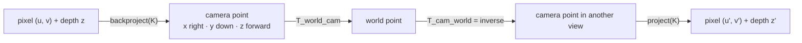

# Geometry and camera conventions

Every direction Basir gives later ("turn right ~120°, go about 2.3 m") is computed from this geometry, so it has one convention everywhere and is tested before anything else.

The code is in [`basir/core/geometry.py`](../basir/core/geometry.py) (pure numpy, vectorised, no I/O) and the data types in [`basir/core/types.py`](../basir/core/types.py).

## Conventions

| What | Convention |
|---|---|
| Camera frame | OpenCV / TUM optical frame: **x right, y down, z forward**, in metres |
| Pose | **`T_world_cam`**: the 4x4 rigid transform that takes camera-frame points to the world frame (camera → world) |
| Inverse pose | `T_cam_world = Pose.inverse()` (world → camera), used to project world points into a view |
| Quaternions | `(x, y, z, w)` order, as in TUM ground truth and SciPy; normalised before use |
| Depth | `float32` metres; **0 means "no reading"** |
| Points | `N x 3` arrays; a single point may be a 3-vector |
| Images | `H x W x 3` `uint8` in **RGB** order (OpenCV's BGR is converted on load) |
| TUM world frame | The x-y plane is the floor plane, which the top-down image uses |

## Core types

| Type | Holds |
|---|---|
| `CameraIntrinsics` | `fx`, `fy`, `cx`, `cy`, `width`, `height`, `depth_scale` (raw depth / `depth_scale` = metres; TUM: 5000). `K` is the 3x3 matrix; `scaled(w, h)` gives the same camera at another image size (pixel-centre convention) |
| `Pose` | `matrix` (`T_world_cam`, must be 4x4) and `timestamp`. `Pose.from_tum(t, tx, ty, tz, qx, qy, qz, qw)` builds one from a TUM ground-truth line; `position` is the camera centre in world coordinates |
| `Frame` | `id`, `timestamp`, `rgb`, `intrinsics`, and optional `depth` and `pose` |

## Functions

| Function | Does |
|---|---|
| `quaternion_to_matrix(qx, qy, qz, qw)` | 3x3 rotation; rejects a zero-length quaternion |
| `make_transform(R, t)`, `invert_transform(T)`, `transform_points(T, P)` | Rigid transforms; the inverse is `[Rᵀ \| −Rᵀt]` |
| `backproject(u, v, z, K)` | Pixel + depth → camera point |
| `project(P, K)` | Camera point → `(u, v, z)`; points with `z ≤ 0` (behind the camera) get `u = v = NaN` |
| `depth_to_points(depth, K, stride, min_depth=0.1, max_depth=8.0)` | Valid depth pixels → camera points, plus their row / column indices so callers can fetch colours |
| `frame_to_world_points(frame, stride)` | One posed RGB-D frame → world points and their RGB colours |
| `depth_consistency(frame_i, frame_j)` | The multi-view score below |

## The depth-consistency score

`depth_consistency` is the number that tells you whether the geometry is right before you look at a single point cloud:

1. Lift frame *i*'s depth to world points (every 4th pixel, depths up to 4 m).
2. Move them into frame *j* with `T_cam_world` of *j* and project them with *j*'s intrinsics.
3. Where a point lands inside *j*'s image on a valid depth pixel, compare its predicted depth with what *j* actually measured.

It returns a `DepthConsistency` with the **median** and **90th percentile** of the absolute residual in cm, the **fraction within 5 cm**, and how many points were compared (or `None` if the two views share no valid pixels). With correct poses, intrinsics and axes the residual is sensor noise of a few cm; a pose or axis bug shows up as tens of cm. The Phase 0 gate built on it is described in [Replay and point clouds](05-replay-and-pointcloud.md#the-phase-0-gate).

## Camera intrinsics

Intrinsics are chosen **per dataset**, by [`calibration_for`](../basir/ingest/datasets/tum_format.py), in this order:

1. The dataset folder's own `intrinsics.json` (any keys of `CameraIntrinsics`).
2. The TUM calibration for the sensor named in the folder name (`freiburg1`, `freiburg2`, `freiburg3`).
3. The default camera on `Settings` (TUM / Kinect v1).

| Sensor | fx | fy | cx | cy |
|---|---|---|---|---|
| `freiburg1` | 517.3 | 516.5 | 318.6 | 255.3 |
| `freiburg2` | 520.9 | 521.0 | 325.1 | 249.7 |
| `freiburg3` | 535.4 | 539.2 | 320.1 | 247.6 |
| default (Kinect v1) | 525.0 | 525.0 | 319.5 | 239.5 |

All are 640x480 with a **depth factor of 5000** (`TUM_DEPTH_FACTOR`): a TUM depth PNG stores metres x 5000, so a raw value of 5000 is 1 m. fr1 and fr2 also have mild lens distortion, which Basir ignores for now. Where the intrinsics came from is logged to MLflow as the `intrinsics_source` param of every replay and point-cloud run.

## Tests

The geometry tests are mandatory: every later phase depends on them. They cover the round trips (project ∘ backproject, transform ∘ inverse), hand-checked rotations, agreement with SciPy, axis directions, points behind the camera, and a deliberate pose-sign bug that the consistency score must catch. See [`tests/test_geometry.py`](../tests/test_geometry.py).
