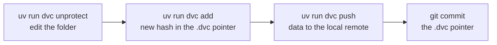

# Data versioning with DVC

[DVC](https://dvc.org) versions the datasets Basir is checked against, so every result traces back to the exact data it came from. Git holds only small `.dvc` pointer files; the data itself stays out of git.

## Commands

DVC is in the `dev` dependency group, so `uv sync` installs it and every command runs through `uv run`.

```bash
uv run dvc pull                                        # restore every tracked dataset from the remote
uv run dvc pull datasets/rgbd_dataset_freiburg1_desk.dvc   # restore one dataset only
uv run dvc status                                      # did the datasets on disk change since the last dvc add?
uv run dvc status -c                                   # is the remote in sync with the pointers?
uv run dvc unprotect datasets/rgbd_dataset_freiburg1_desk  # make tracked files writable before editing them
uv run dvc add datasets/rgbd_dataset_freiburg1_desk    # record a new version after a change
uv run dvc push                                        # upload that version to the remote
```

On this machine `uv run dvc pull` replaces the two Phase 0 downloads in the [quickstart](../README.md#quickstart).

## What's tracked

| Tracked path | Pointer | Size | Files |
|---|---|---|---|
| `datasets/rgbd_dataset_freiburg1_desk/` | [`datasets/rgbd_dataset_freiburg1_desk.dvc`](../datasets/rgbd_dataset_freiburg1_desk.dvc) | 367 MB | 1,215 |
| `datasets/rgbd_dataset_freiburg1_room/` | [`datasets/rgbd_dataset_freiburg1_room.dvc`](../datasets/rgbd_dataset_freiburg1_room.dvc) | 838 MB | 2,729 |

Each dataset has its own pointer, so one can be pulled, changed or pushed alone. The tracked folders are the prepared ones, including Basir's `associations*.txt` and `dataset_meta.json`.

Not tracked by DVC:

| Path | Why |
|---|---|
| `datasets/_archives/` | The downloaded `.tgz` files duplicate the extracted folders |
| `outputs/` | Rebuilt by `visualize_pointcloud.py` and the pipeline |
| `mlflow.db`, `mlartifacts/` | The MLflow store has its own lifecycle |
| `env/.env` | Secrets |

## Remote and cache

The configuration is in [`.dvc/config`](../.dvc/config):

| Setting | Value | Effect |
|---|---|---|
| `core.remote` | `local` | The default remote |
| `remote "local".url` | `/run/media/omar/My Passport/dvc-remotes/Basir` | A folder on the same drive, outside the repo. Nothing is uploaded off the machine |
| `cache.type` | `hardlink` | The workspace files are hardlinks into `.dvc/cache`, so the data isn't stored twice on the drive |
| `core.autostage` | `false` | `dvc add` doesn't run `git add` for you; commit the `.dvc` pointer yourself |

**Hardlinked files are read-only.** Editing one in place would also change the cached copy, so DVC protects them. Run `uv run dvc unprotect <path>` first (it replaces the links with real copies), edit, then `uv run dvc add <path>` and `uv run dvc push`, and commit the updated pointer.

## Recording a new dataset version



Every MLflow run is tagged with the git commit (see [Experiment tracking](06-experiment-tracking.md#standard-tags)), and that commit pins the `.dvc` pointers, so a run can be traced back to the exact dataset version.
