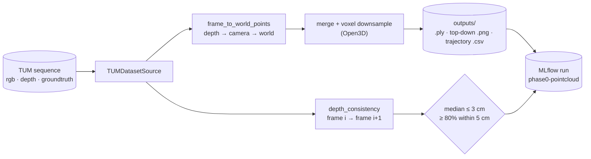

# Replay and the Phase 0 point-cloud check

Phase 0 is done when a real recorded room comes out as **one clean point cloud**, and the numbers agree with what you see. Two scripts get there: `replay.py` plays a sequence back so you can look at it, and `visualize_pointcloud.py` fuses it into a cloud and scores it.

## Replay

```bash
uv run python scripts/replay.py fr1/desk                  # RGB + depth at real-time speed
uv run python scripts/replay.py fr1/desk --speed 2        # 2x; 0 = as fast as possible
uv run python scripts/replay.py datasets/my_recording     # any TUM-layout folder
uv run python scripts/replay.py fr1/desk --no-window      # headless: statistics only
```

| Option | Default | Does |
|---|---|---|
| `dataset` | | Preset key or dataset folder (must be downloaded) |
| `--speed` | 1 | Playback speed; 0 = as fast as possible |
| `--stride` | 1 | Use every Nth frame |
| `--max-frames` | all | Stop after this many frames |
| `--no-window` | off | Headless: print statistics only |

The window shows RGB beside colourised depth (0 to 5 m, turbo colour map, black where there's no reading) with the frame index, time and camera position. **Keys:** space pauses, `q` or Esc quits.

Pacing is separate from display ([`basir/ingest/playback.py`](../basir/ingest/playback.py)): `Pacer` sleeps so frames follow their sensor timestamps scaled by `speed`, excluding paused time, and `play()` counts frames into `PlaybackStats`. The same pacing serves the viewer, the tests and the headless `replay` step of the pipeline.

Each run is logged to MLflow, experiment **`phase0-replay`**: params `dataset`, `speed`, `stride`, `frames_available`, `intrinsics_source`; metrics `frames`, `fps`, `depth_valid_pct` (share of pixels with a depth reading) and `wall_seconds`.

## The point-cloud check

```bash
uv run python scripts/visualize_pointcloud.py fr1/room                    # the Phase 0 check
uv run python scripts/visualize_pointcloud.py fr1/desk --every 10 --voxel 0.01
uv run python scripts/visualize_pointcloud.py fr1/room --no-window        # save files only, no viewer
```

| Option | Default | Does |
|---|---|---|
| `dataset` | | Preset key or dataset folder |
| `--every` | 15 | Use every Nth frame (~2 per second) |
| `--pixel-stride` | 4 | Use every Nth pixel in each frame |
| `--voxel` | 0.02 | Voxel size in metres for downsampling; 0 = off |
| `--gap` | 1 | Consistency: compare selected frames this many apart |
| `--max-frames` | all | Stop after this many frames |
| `--save` | `outputs/<dataset>.ply` | Output `.ply` |
| `--no-window` | off | Save files only; don't open the Open3D viewer |

One run does the following, as defined in [`scripts/visualize_pointcloud.py`](../scripts/visualize_pointcloud.py) and [`basir/spatial/fusion.py`](../basir/spatial/fusion.py):

1. **Load.** [`TUMDatasetSource`](../basir/ingest/sources/tum.py) reads every Nth frame: RGB, depth in metres and the pose `T_world_cam`. The intrinsics come from the dataset's own calibration (freiburg1 / 2 / 3), not a generic default.
2. **Lift to 3D.** `frame_to_world_points` back-projects each depth pixel and moves it into the world frame with the frame's pose (see [Geometry](02-geometry.md)).
3. **Fuse.** [`build_cloud`](../basir/spatial/pointcloud.py) merges all frames into one coloured cloud, voxel-downsampled with Open3D.
4. **Score.** `depth_consistency`, averaged over consecutive frame pairs by `average_consistency` (weighted by the points each pair compared), projects each frame's surfaces into the next frame and compares them against that frame's own depth. Correct geometry leaves only sensor noise of a few cm; a pose or axis bug shows up as tens of cm, before you even look at the cloud.
5. **Save and log.** It writes `outputs/<dataset>.ply`, a top-down image (`.topdown.png`: the world x-y plane with the camera path in red) and the camera trajectory (`.trajectory.csv`: `timestamp,x,y,z`), and logs params, metrics and those files to MLflow, experiment **`phase0-pointcloud`**.



The script prints the frame and point counts, the consistency numbers with **PASS** or **CHECK**, and the saved paths, then opens the cloud with the red trajectory and an axes marker.

**Metrics logged:** `frames_used`, `points_raw`, `points_downsampled`, `seconds`, `consistency_median_cm`, `consistency_p90_cm`, `consistency_within_5cm`, `consistency_pairs`, and `passes` (1.0 or 0.0).

## The Phase 0 gate

| Target | Value |
|---|---|
| Median consistency residual | **≤ 3 cm** |
| Points within 5 cm | **≥ 80 %** |

Both must hold (`meets_targets` in [`fusion.py`](../basir/spatial/fusion.py)). The same check is the `gate` step of the [Phase 0 pipeline](07-pipelines.md), which fails if any cloud misses it.

**Visual pass criteria:** the cloud of `fr1/room` shows walls, desk and floor sharp, with no doubled or ghost surfaces, and the red trajectory follows the walk.

### Results

| Sequence | Median residual | Within 5 cm | Verdict |
|---|---|---|---|
| `fr1/desk` | 1.89 cm | 84 % | Pass |
| `fr1/room` | 1.81 cm | 82 % | Pass |

Both sequences pass the numeric gate; the final visual check of the room is still pending.
