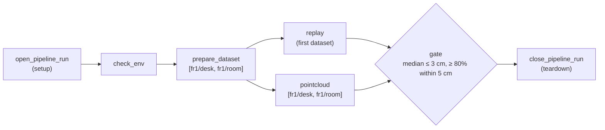
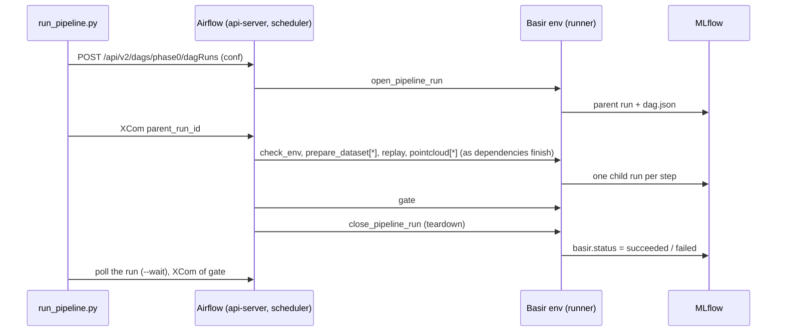

# Pipelines

Multi-step jobs run as **Apache Airflow DAGs** (Airflow 3.3, in the [local stack](08-local-stack.md)). The first one is the whole Phase 0 check, the DAG `phase0`. Airflow records every task's state, attempts, timing and log, so a pipeline that fails halfway shows exactly where and why. The Airflow UI and the Console's Pipelines tab show it live, and every run is mirrored in MLflow as one parent run with a child run per step.

The code:

| Where | What |
|---|---|
| [`dags/`](../dags/phase0.py) | The DAG files Airflow parses: `phase0.py` |
| [`basir/pipelines/phase0.py`](../basir/pipelines/phase0.py) | The DAG's shape (`phase0_dag`) and params, with no third-party imports |
| [`basir/pipelines/phase0_steps.py`](../basir/pipelines/phase0_steps.py) | The step logic and its MLflow logging, `execute` (one step by name) and `run_locally` (the whole DAG in-process) |
| [`basir/pipelines/runner.py`](../basir/pipelines/runner.py) | Runs one step in Basir's Python environment, with JSON in and out |
| [`basir/pipelines/airflow_task.py`](../basir/pipelines/airflow_task.py) | The Airflow side: starts the runner and turns a non-retryable failure into a failed task |
| [`basir/pipelines/airflow_client.py`](../basir/pipelines/airflow_client.py) | The REST client used by `run_pipeline.py` and the Console |
| [`basir/pipelines/dag.py`](../basir/pipelines/dag.py) | The `Dag` / `Step` types and the `dag.json` / `dag.mmd` they write |

## Run it

Start the stack first (`scripts/stack.sh up`). Airflow's UI and REST API are at `http://127.0.0.1:8080`. The user is `admin` and the password is `AIRFLOW_ADMIN_PASSWORD` in `env/stack.env`.

```bash
uv run python scripts/run_pipeline.py phase0 --wait               # fr1/desk + fr1/room
uv run python scripts/run_pipeline.py phase0 --datasets fr1/desk --every 10
```

`run_pipeline.py` triggers a DAG run through the REST API. It prints three lines: the run ID, the run's page in the **Airflow UI** (graph, task states, logs, attempts) and the **MLflow** parent run. With `--wait` it then polls until the run ends, prints each cloud's numbers, and exits with 1 if the pipeline fails, naming the failed task and the error its step reported:

```text
Run       phase0-20261112-184518-3316b3
Airflow   http://127.0.0.1:8080/dags/phase0/runs/phase0-20261112-184518-3316b3
MLflow    http://127.0.0.1:5000/#/experiments/4/runs/2a7bf5fd4c11424cb3ac397ce46f10ad
PASS      fr1/desk: median 1.89 cm, 84% within 5 cm (39 frames, 100,576 points)
PASS      fr1/room: median 1.81 cm, 82% within 5 cm (91 frames, 422,032 points)
```

| `run_pipeline.py` option | Default | Does |
|---|---|---|
| `pipeline` | | The pipeline to start; `phase0` is the only one so far |
| `--datasets` | `fr1/desk fr1/room` | Preset keys or folders; the first one is also replayed |
| `--every` | 15 | Point cloud: use every Nth frame |
| `--pixel-stride` | 4 | Point cloud: use every Nth pixel |
| `--voxel` | 0.02 | Point cloud: voxel size in metres; 0 = off |
| `--replay-stride` | 1 | Replay: use every Nth frame |
| `--max-frames` | all | Frame limit for every step |
| `--wait` | off | Wait for the result; exit 1 if the pipeline fails |

The script connects to `AIRFLOW_URL` as `AIRFLOW_USERNAME` / `AIRFLOW_PASSWORD` (from `env/.env`; a blank password falls back to `AIRFLOW_ADMIN_PASSWORD` in `env/stack.env`). It exits with 1 if Airflow can't be reached. You can also trigger from the Airflow UI ("Trigger" opens a form with every param), or with `POST /api/v2/dags/phase0/dagRuns` and a `conf` holding the overrides.

### Params

Every param is a DAG param with a JSON Schema, so the trigger form validates it. A run's `conf` overrides any of them:

| Param | Default | Does |
|---|---|---|
| `datasets` | `["fr1/desk", "fr1/room"]` | Preset keys or folders (at least one); the first is also replayed |
| `every` | 15 | Point cloud: use every Nth frame |
| `pixel_stride` | 4 | Point cloud: use every Nth pixel |
| `voxel` | 0.02 | Point cloud: voxel size in metres; 0 = off |
| `gap` | 1 | Point cloud: score frame i against frame i+gap |
| `replay_stride` | 1 | Replay: use every Nth frame |
| `replay_speed` | 0 | Replay: 1 = real time, 0 = as fast as possible |
| `max_frames` | null | Frame limit for every step |

## The DAG



`prepare_dataset` and `pointcloud` are **mapped tasks**: one instance per dataset, named after it (`map_index_template`), so the two datasets are prepared and fused in parallel. With LocalExecutor at most 4 tasks run at once.

| Task | Does | Retries, timeout |
|---|---|---|
| `open_pipeline_run` | Opens the MLflow parent run with `dag.json` / `dag.mmd`; pushes its ID and the datasets as XComs | 3 retries, 10 s apart; 10 min |
| `check_env` | Checks Basir's environment has every package and a writable outputs folder; logs versions, device, data folder and MLflow URI | 1 retry (none for a missing package); 10 min |
| `prepare_dataset[d]` | Finds the dataset on disk, **downloading and indexing it first if needed**; logs its path and frame count | 2 retries, 10 s apart; 2 h |
| `replay` | Plays the first dataset headless, as fast as possible; logs fps and depth coverage | 1 retry; 30 min |
| `pointcloud[d]` | Fuses, scores and saves the cloud exactly as [`visualize_pointcloud.py`](05-replay-and-pointcloud.md#the-point-cloud-check) does | 1 retry; 1 h |
| `gate` | Passes only if **every** cloud meets the [Phase 0 targets](05-replay-and-pointcloud.md#the-phase-0-gate); otherwise fails with `GateFailed`, naming each cloud and number that missed | None: the verdict is deterministic; 10 min |
| `close_pipeline_run` | Marks the parent run `succeeded` (the gate returned) or `failed` (anything else) and ends it | 3 retries; 10 min |

Data errors (a missing dataset, a bad param, a failed gate: `FileNotFoundError`, `ValueError`, `StepFailed`) fail the task at once, without retries. Other errors (MLflow unreachable, a killed process) use the retries above. Every timeout is at least 10 minutes, because the first step on a cold start imports torch, open3d and MLflow from a slow disk.

`close_pipeline_run` is the **teardown** of `open_pipeline_run`, so it runs whatever happened in between. Airflow leaves teardowns out when it decides the run's state, so a failed gate still fails the DAG run.

## How it's built

- **Two Python environments, one image.** Airflow pins versions of FastAPI, Pydantic and SQLAlchemy that Basir has moved past, so the image ([`Docker/airflow`](../Docker/airflow/Dockerfile)) keeps Airflow's environment as shipped and adds Basir's at `/opt/basir-venv` from `uv.lock` (CPU torch). Airflow parses `dags/` and runs each task's small wrapper. The wrapper runs `python -m basir.pipelines.runner phase0 <task>` in Basir's environment, and its output lands in the task log. Airflow is **not** installed in the project venv.
- **The DAG is data, checked against Airflow.** `phase0_dag(datasets)` returns the per-dataset `Dag` that is logged to MLflow as `dag.json` / `dag.mmd`. Node ids are `<task id>[:<dataset>]` (`pointcloud:fr1/room`). `dags/phase0.py` refuses to load (an import error in Airflow) unless its task edges equal that DAG's edges between tasks (`Dag.task_edges`), so the two can't drift. `tests/test_dags.py` checks the same.
- **Payloads are small.** Tasks exchange paths and numbers only (`PreparedDataset`, `ReplayResult`, `PointcloudResult` as JSON XComs), never frames or clouds. Clouds and images stay on disk and in MLflow.
- **Same paths everywhere.** The containers mount `datasets/` and `outputs/` at their host paths (`BASIR_DATA_DIR`), and log to `http://mlflow:5000`, whose artifact proxy stores files in the host's `mlartifacts/`. Every path logged to MLflow is valid on the host.
- **Code is mounted, not baked.** `basir/`, `utilities/` and `dags/` are mounted read-only at `/opt/basir`. Changing a step or a DAG needs no rebuild (the dag-processor re-parses within seconds); changing `uv.lock` does (`scripts/stack.sh up` rebuilds).
- **Without Airflow.** `phase0_steps.run_locally(params, run_id)` walks the same DAG in one process. The tests use it to check the MLflow runs on toy datasets.



## The MLflow mapping

Unchanged from before Airflow, so the Experiments page and the existing views keep working. Experiment `phase0-pipeline`:

| Run | Tags | Artifacts |
|---|---|---|
| Parent, named after the Airflow run ID | `basir.pipeline` = `phase0`, `basir.workflow_id` = the Airflow `run_id`, `basir.status` = running / succeeded / failed | `dag.json`, `dag.mmd` |
| One child per step (7 for two datasets) | `basir.step` = the node id, `basir.depends_on` = its dependencies (comma-separated), `basir.status`, `basir.dataset` | The step's own files (the cloud, its top-down view, the trajectory) |

More in [Experiment tracking](06-experiment-tracking.md#pipeline-runs-parent-and-child).

## Adding a DAG

1. Put the step logic in `basir/pipelines/<name>_steps.py`: plain functions that take and return small dataclasses and log a child run with `_step_run`-style tags. Add an `execute(task, payload)` dispatcher and register it in `runner.PIPELINES`.
2. Describe the shape in `basir/pipelines/<name>.py` (a `Dag` builder and the params), with no third-party imports, because Airflow's interpreter imports it.
3. Write `dags/<name>.py` with the TaskFlow API. Each task calls `run_step("<name>", "<task>", payload)` and maps `StepFailed` to `AirflowFailException`. Open and close the MLflow parent run as setup and teardown, as `dags/phase0.py` does. Add the drift check at the bottom.
4. Add tests: the step logic in the project venv, the DagBag in `tests/test_dags.py`.

Planned DAGs follow the same pattern: dataset preparation, post-session processing of recorded phone sessions, evaluations. A scheduled DAG only needs `schedule=` (a cron string or an asset).

**GPU steps.** The Airflow image has CPU torch and no GPU, which is enough for Phase 0. A step that needs the GPU has two routes. The first is a `DockerOperator` (`apache-airflow-providers-docker`) that starts a Basir image with the NVIDIA runtime (`device_requests=[DeviceRequest(count=-1, capabilities=[["gpu"]])]`), mounting the Docker socket into the worker. The second is an HTTP call from a plain task to the Basir server, which already owns the GPU worker. The HTTP route fits when the model is the server's; the container fits batch jobs that would compete with live frames.

## Where to look

| Place | Shows |
|---|---|
| Airflow UI, `http://127.0.0.1:8080` | Every DAG run: the graph, each task's state, attempts, duration and **log** (Browse → Task Instances, or click a task) |
| MLflow, experiment `phase0-pipeline` | The parent run with the DAG, and one child run per step with its params, metrics and files |
| Console, Pipelines tab | Both at once: running DAG runs first with each task's state, then recent pipeline runs with the DAG drawn and each step coloured by its Airflow state (MLflow's `basir.status` when Airflow doesn't know the run), plus the Airflow UI embedded ([Server and UI](09-server-and-ui.md)) |
| Grafana, *Airflow* dashboard | Scheduler heartbeat, DAG runs by state, task instances by state, task and DAG run durations, queued tasks and executor slots ([Local stack](08-local-stack.md#grafana-dashboards)) |
| `docker compose ... logs airflow-scheduler` | The scheduler; task logs are in the `airflow-logs` volume and the UI |

### Testing the DAG files

The DagBag tests need Airflow, so they run in the Airflow image (they skip in the project venv):

```bash
BASIR_DATA_DIR=$PWD docker compose -f Docker/docker-compose.yml --env-file env/stack.env \
    run --rm --no-deps -v "$PWD/tests:/opt/basir/tests:ro" airflow-scheduler \
    python -m pytest --noconftest -p no:cacheprovider -o addopts= /opt/basir/tests/test_dags.py
```

With the stack up, `uv run pytest -m network tests/test_airflow_e2e.py` triggers Phase 0 for real and checks that the parent run has seven child runs with the right `basir.depends_on`.

Why pipelines run on Airflow while live frames don't is explained in [Async processing](10-async-processing.md).
