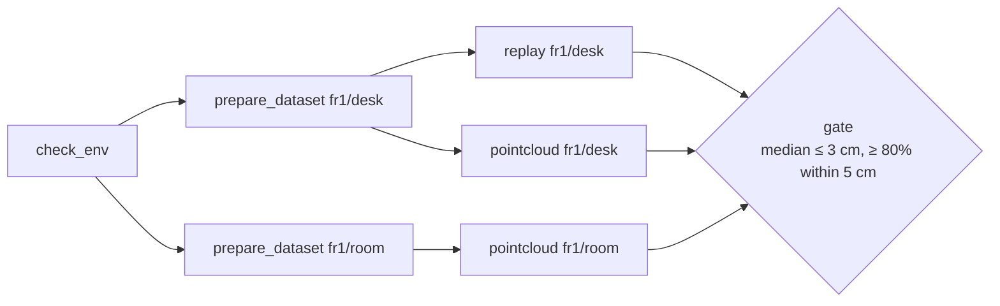
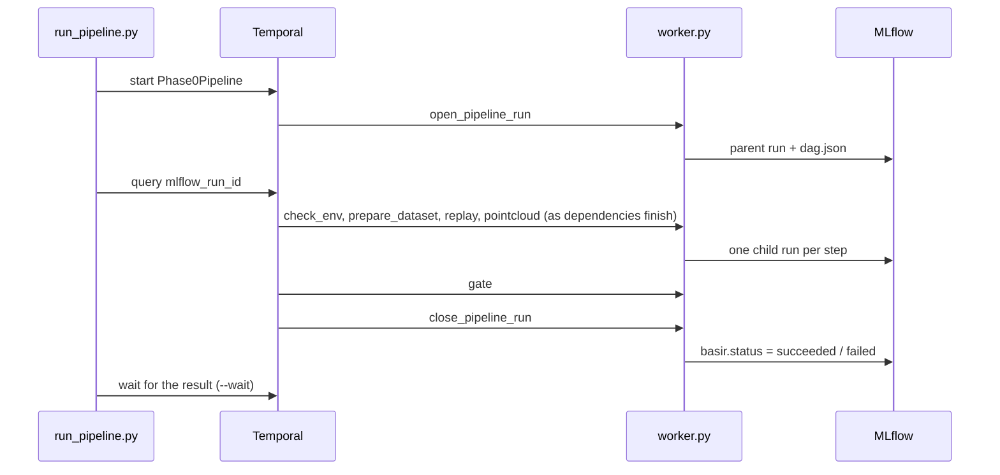

# Pipelines

The whole Phase 0 check also runs as one durable **Temporal workflow**, `Phase0Pipeline`. Temporal records every step's inputs, result, retries and timing, so a pipeline that fails halfway shows exactly where and why, and the Temporal UI and the server's Pipelines page show it live.

The code is in [`basir/pipelines`](../basir/pipelines/__init__.py): the DAG type ([`dag.py`](../basir/pipelines/dag.py)), the workflow ([`phase0.py`](../basir/pipelines/phase0.py)), its activities ([`phase0_steps.py`](../basir/pipelines/phase0_steps.py)) and the client / worker wiring ([`runtime.py`](../basir/pipelines/runtime.py)).

## Run it

Temporal must be running: the [local stack](08-local-stack.md) (`scripts/stack.sh up`) serves it on `127.0.0.1:7233`, or, with the Temporal CLI installed, `temporal server start-dev`.

```bash
uv run python scripts/worker.py                                   # worker on task queue basir-pipelines (keep it running)
uv run python scripts/run_pipeline.py phase0 --wait               # fr1/desk + fr1/room
uv run python scripts/run_pipeline.py phase0 --datasets fr1/desk --every 10
```

`run_pipeline.py` prints the workflow ID, its page in the **Temporal UI** (`http://127.0.0.1:8233`: the step timeline, inputs, results, retries) and the **MLflow** parent run. With `--wait` it then prints each cloud's numbers and exits with 1 if the pipeline fails, naming the cause.

| `run_pipeline.py` option | Default | Does |
|---|---|---|
| `pipeline` | | The pipeline to start; `phase0` is the only one so far |
| `--datasets` | `fr1/desk fr1/room` | Preset keys or folders; the first one is also replayed |
| `--every` | 15 | Point cloud: use every Nth frame |
| `--pixel-stride` | 4 | Point cloud: use every Nth pixel |
| `--voxel` | 0.02 | Point cloud: voxel size in metres; 0 = off |
| `--replay-stride` | 1 | Replay: use every Nth frame |
| `--max-frames` | all | Frame limit for every step |
| `--wait` | off | Wait for the result; exit 1 if the pipeline fails |

| `worker.py` option | Default | Does |
|---|---|---|
| `--concurrency` | 4 | Activities that may run at once (in a thread pool, so parallel steps overlap) |

Workflow IDs look like `phase0-20261111-143000-a1b2c3`. Both scripts connect to `TEMPORAL_ADDRESS` and exit with 1 if Temporal can't be reached.

## The DAG

Each step is a Temporal activity that starts as soon as the steps it depends on have finished, so the two datasets are prepared and fused in parallel.



| Step | Activity does | Retries |
|---|---|---|
| `check_env` | Checks the worker has every package and a writable outputs folder; logs versions, device, data folder and MLflow URI | 2 attempts; a missing package fails without retry |
| `prepare_dataset:<d>` | Finds the dataset on disk, **downloading and indexing it first if needed**; logs its path and frame count | 3 attempts, 10 s apart; a bad name or missing data doesn't retry |
| `replay:<first>` | Plays the first dataset headless, as fast as possible; logs fps and depth coverage | 2 attempts |
| `pointcloud:<d>` | Fuses, scores and saves the cloud exactly as [`visualize_pointcloud.py`](05-replay-and-pointcloud.md#the-point-cloud-check) does | 2 attempts |
| `gate` | Passes only if **every** cloud meets the [Phase 0 targets](05-replay-and-pointcloud.md#the-phase-0-gate); otherwise fails with `GateFailed`, naming each cloud and number that missed | None: the verdict is deterministic |

Long steps heartbeat every 10 s from a background thread, so Temporal notices a dead worker within a couple of minutes instead of waiting for the step's timeout.

## How it's built

- **The DAG is data.** `phase0_dag(datasets)` returns a `Dag` of `Step`s (name, activity, dataset, dependencies). The workflow walks that same object, starting one asyncio task per step that first awaits its dependencies, so the DAG logged to MLflow is exactly what runs. `Dag` checks that names are unique, comma-free, and that every dependency comes earlier.
- **The workflow stays deterministic.** All I/O, including MLflow, happens in the activities; the workflow code only schedules them.
- **Payloads are small.** Activities exchange paths and numbers only (`PreparedDataset`, `ReplayResult`, `PointcloudResult`), never frames or clouds: Temporal limits a payload to 2 MB. Clouds and images stay on disk and in MLflow.
- **One parent MLflow run.** The first activity opens it with `dag.json` and `dag.mmd` attached; the workflow exposes its ID through the `mlflow_run_id` query, which is how `run_pipeline.py` finds it. Each step logs a nested child run, and the last activity closes the parent as `succeeded` or `failed`. The tags are listed in [Experiment tracking](06-experiment-tracking.md#pipeline-runs-parent-and-child).
- **One worker, one task queue.** [`runtime.py`](../basir/pipelines/runtime.py) registers every workflow and activity on the task queue `basir-pipelines` in the `default` namespace.



## Where to look

| Place | Shows |
|---|---|
| Temporal UI, `http://127.0.0.1:8233` | Every workflow: step timeline, inputs, results, retries, the failure message |
| MLflow, experiment `phase0-pipeline` | The parent run with the DAG, and one child run per step with its params, metrics and files |
| Server UI, `/pipelines` | Both at once: running workflows first, then recent pipeline runs with the DAG drawn and each step coloured by `basir.status` ([Server and UI](09-server-and-ui.md)) |
| Grafana, *Temporal* dashboard | Workflow outcomes, activity calls and latencies over time ([Local stack](08-local-stack.md#grafana-dashboards)) |

Why pipelines run on Temporal while live frames don't is explained in [Async processing](10-async-processing.md).
