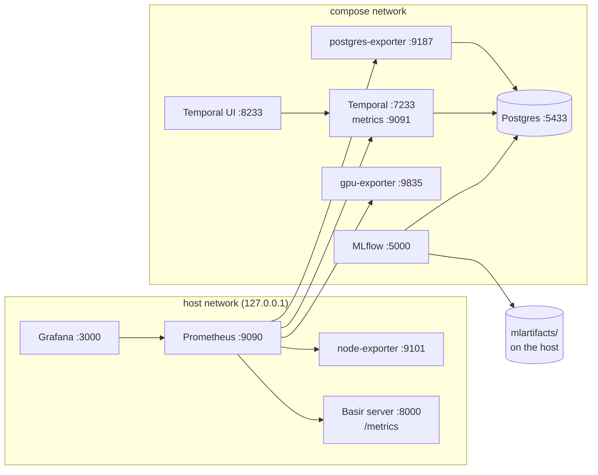

# Local stack

One Docker Compose project runs the services around Basir: experiment tracking (MLflow), the workflow engine (Temporal) and monitoring (Prometheus, Grafana and exporters). Everything binds to `127.0.0.1`, images are pinned, every container has a healthcheck, and data lives in named volumes (MLflow artifacts stay on the host, in `mlartifacts/`).

## Commands

```bash
scripts/stack.sh up             # build, start, wait until every container is healthy (up to 5 min), print the URLs
scripts/stack.sh status         # containers, URLs and Prometheus target health
scripts/stack.sh logs mlflow    # follow one or more services' logs (all without a name)
scripts/stack.sh down           # stop; volumes are kept
```

Then point Basir at the MLflow server with `MLFLOW_TRACKING_URI=http://127.0.0.1:5000` in `env/.env`. Without it, runs go to the local SQLite file as before (the tests always use SQLite).

## Native Docker Engine, for the GPU

The stack runs on the **native Docker Engine** (Docker context `default`), because Docker Desktop's VM can't reach the GPU.

```bash
sudo systemctl start docker     # start the engine; stack.sh says so when it can't reach it
docker context ls               # `default` is the native engine
```

Set `BASIR_DOCKER_CONTEXT` to use another context. The GPU exporter also needs the **NVIDIA Container Toolkit**.

## Layout

The Docker files live under `Docker/`, one subdirectory per service, tied together by a single Compose file. The env files live under `env/`.

```text
Docker/
├── docker-compose.yml           # the whole stack; scripts/stack.sh runs it
├── postgres/                    # creates the mlflow, temporal and temporal_visibility databases
├── mlflow/                      # MLflow server image (Postgres driver, migrates its schema on start)
├── prometheus/                  # prometheus.yml: the scrape targets
├── grafana/                     # datasource + dashboard provisioning, dashboard JSON
└── <service>/                   # one folder per further service
env/
├── .env.example                 # Basir settings template (see Setup)
├── .env                         # your Basir settings (git-ignored)
├── stack.env.example            # stack passwords and ports template
└── stack.env                    # created by `scripts/stack.sh up` (git-ignored)
```

## Services

| Service | URL | What it does |
|---|---|---|
| **MLflow** | http://127.0.0.1:5000 | Tracking server on Postgres; migrates its schema on start and stores artifacts in `mlartifacts/` on the host |
| **Temporal** | `127.0.0.1:7233` (gRPC) | Workflow engine for the [pipelines](07-pipelines.md) (auto-setup on Postgres) |
| **Temporal UI** | http://127.0.0.1:8233 | Workflow history; allows the Basir server's origin (`:8000`) |
| **Grafana** | http://127.0.0.1:3000 | Dashboards; anonymous viewers allowed and embedding on, admin login in `env/stack.env` |
| **Prometheus** | http://127.0.0.1:9090 | Scrapes the host, GPU, Postgres, Temporal and the Basir server; keeps 30 days |
| **Postgres** | `127.0.0.1:5433` | Databases `mlflow`, `temporal`, `temporal_visibility` (5433 because 5432 is often taken by a system Postgres) |
| node-exporter | `127.0.0.1:9101` | Host metrics (CPU, memory, disks incl. the data drive, network) |
| gpu-exporter | `127.0.0.1:9835` | NVIDIA GPU metrics (`nvidia-smi`) |
| postgres-exporter | `127.0.0.1:9187` | Postgres metrics |
| Temporal metrics | `127.0.0.1:9091` | Temporal's own Prometheus endpoint |

### Prometheus targets

| Job | Target | Interval |
|---|---|---|
| `prometheus` | `127.0.0.1:9090` | 15 s |
| `node` | `127.0.0.1:9101` | 15 s |
| `gpu` | `127.0.0.1:9835` | 15 s |
| `postgres` | `127.0.0.1:9187` | 15 s |
| `temporal` | `127.0.0.1:9091` | 15 s |
| `basir` | `127.0.0.1:8000` (`/metrics`) | 5 s |

**The `basir` target is DOWN** until the Basir server runs on port 8000 (`uv run python scripts/serve.py`). That's expected. `uv run pytest -m network` checks that every other target is up.



Notes:

- **Prometheus, Grafana and node-exporter use the host network**, so they can reach loopback-only services such as the Basir server and report the laptop's real network interfaces. node-exporter runs as your user so it can read drives mounted under `/run/media/<user>`.
- **Logs are capped** at 3 x 10 MB per container.

## Stack settings

`env/stack.env` is read by the Compose file through `scripts/stack.sh`. The first `up` copies `env/stack.env.example` to it with random passwords (`chmod 600`). Edit `env/stack.env`, never the example.

| Setting | Default | Does |
|---|---|---|
| `POSTGRES_USER`, `POSTGRES_PASSWORD` | `basir`, random | Postgres superuser shared by MLflow and Temporal |
| `POSTGRES_PORT` | `5433` | Host port for Postgres |
| `GRAFANA_ADMIN_USER`, `GRAFANA_ADMIN_PASSWORD` | `admin`, random | Grafana admin login (anonymous visitors get the Viewer role) |
| `MLFLOW_ARTIFACTS_DIR` | `./mlartifacts` | Host folder for MLflow artifacts |

## Grafana dashboards

Five dashboards are provisioned into the folder *Basir* from `Docker/grafana/dashboards/`. The Host dashboard is Grafana's home page. Embed one panel with:

```text
http://127.0.0.1:3000/d-solo/<uid>/?orgId=1&panelId=<id>&kiosk&theme=light
```

| Dashboard | uid | Panels (id) |
|---|---|---|
| Host resources | `basir-host` | 1 CPU · 2 memory · 3 root disk · 4 data drive (My Passport) · 5 CPU by mode · 6 memory · 7 disk space per mount · 8 disk I/O · 9 network · 10 load |
| GPU | `basir-gpu` | 1 utilization · 2 memory · 3 temperature · 4 power · 5 utilization over time · 6 memory · 7 temperature · 8 power vs limit · 9 clocks |
| Postgres | `basir-postgres` | 1 up · 2 connections · 3 `mlflow` size · 4 `temporal` size · 5 connections by database · 6 by state · 7 database size · 8 transactions · 9 rows written · 10 cache hit ratio |
| Temporal | `basir-temporal` | 1 frontend requests/s · 2 workflows completed (1 h) · 3 failed (1 h) · 4 errors/s · 5 workflow outcomes · 6 activity task calls · 7 workflow calls · 8 frontend latency p95 · 9 activity call latency p95 · 10 persistence latency p95 |
| Basir server | `basir-server` | 1 up · 2 WebSocket connections · 3 frames/s · 4 dropped % · 5 queue depth · 6 inference p95 · 7 frames · 8 queue depth and connections · 9 inference latency p50/p95/p99 · 10 batch size · 11 HTTP requests · 12 live map voxels · 13 keyframes fused · 14 map update latency · 15 browser viewers |

The Basir server dashboard reads the `basir_*` metrics listed in [Server and UI](09-server-and-ui.md#metrics). Which panels the server's Dashboards page embeds is set in one place, [`basir/api/grafana.py`](../basir/api/grafana.py); keep it in step when a panel id changes.
