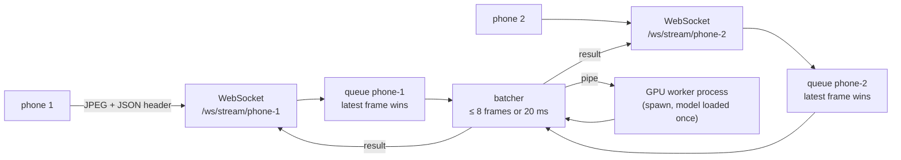

# Server and UI

One process runs the **Basir Console**: it takes frames from several phones at once, runs them on the GPU, shows each phone's colour and depth live, fuses a live 3D map, exports Prometheus metrics at `/metrics` and brings MLflow, Temporal and Grafana into one web UI.

The code is in [`basir/api`](../basir/api/__init__.py).

## Run it

```bash
uv run python scripts/serve.py                         # Console http://127.0.0.1:8000 + phone listener https://<lan-ip>:8001
uv run python scripts/serve.py --no-lan                # no phone listener on the LAN
```

Then open **Devices** and follow the steps (see [Connect a phone](#connect-a-phone)).

On start-up the app spawns the GPU worker and waits until its model is loaded, then starts the batcher; on shutdown it stops both and the live map tasks.

## Listeners: the Console stays on the laptop, phones come in over Wi-Fi

| Listener | Address | Serves |
|---|---|---|
| Console | `127.0.0.1:8000` | Every page, `/metrics`, the Live and map sockets, and `/ws/stream` **without** a token (local test clients) |
| Phones | `INGEST_HOST:INGEST_PORT` (`0.0.0.0:8001`), HTTPS | Only the phone page (`/`), pairing (`/pair`), `/ws/stream/{device_id}` (token required) and `/healthz` |
| MLflow UI | `127.0.0.1:8002` | A frameable copy of MLflow for the Experiments tab |
| Temporal UI | `127.0.0.1:8003` | A frameable copy of the Temporal UI for the Pipelines tab |

All four run in one process and share one state (frame queues, devices, live maps), built by `basir.api.app.create_app`; `basir.api.ingest.create_ingest_app` and `basir.api.embed.create_proxy_app` make the other three. Nothing but the phone stream is reachable from the network.

## Connect a phone

Nothing is installed on the phone: the phone listener serves a **phone page** that pairs and streams from Chrome ([`basir/api/phone`](../basir/api/phone/index.html)). The **Devices** tab walks through it one step at a time and moves to the next step by itself:

1. **Open Basir on the phone.** Same Wi-Fi as the laptop; scan the QR code on the Devices tab (it holds `https://<lan-ip>:8001/`). Chrome warns once about the self-signed certificate: *Advanced*, *Proceed*. The step completes when the phone opens the page.
2. **Approve the phone.** The page asks to pair (`POST /pair` with its device ID) and shows a 4-digit code; the Devices tab shows the same code with **Approve** / **Deny**. On approval the phone collects its token (`GET /pair/{id}`, handed over once) and keeps it in the browser.
3. **Start streaming on the phone.** **Start AR stream** sends colour, depth and the phone's position (WebXR `immersive-ar` with `camera-access` and `depth-sensing`, about 5 frames/s); **Start camera stream** sends colour only (any browser, about 10 frames/s).
4. **Done.** Links to Live and the 3D map. Next time the phone opens the page with its stored token and only has to tap Start; a forgotten phone pairs again by itself.

**What the phone needs.** Chrome. For depth and the 3D map: an ARCore phone with *Google Play Services for AR* and the ARCore Depth API (realme 14 / 15). Without WebXR the page offers the camera stream only. A native app ([ARCore phone app](22-planned-arcore-phone-app.md)) comes later for higher frame rates and background streaming; it will speak the same protocol and pairing.

**HTTPS.** Phone browsers allow the camera and WebXR only on secure pages, so the phone listener serves HTTPS with a self-signed certificate made at start-up for the laptop's LAN address ([`tls.py`](../basir/api/tls.py), kept in `<DATA_DIR>/certs/`, remade when the address changes). `INGEST_TLS=false` turns it off.

**Pose and depth from WebXR.** The page converts WebXR's camera (y up, looking down -z) to Basir's camera convention (y down, z forward), takes the intrinsics from the view's projection matrix, and samples depth on a 160-column grid aligned with the colour image, in millimetres. WebXR's world is y-up: set *World up axis* to **Y (ARCore)** in the 3D map.

**Tokens.** Only a token's SHA-256 hash is stored, in `<DATA_DIR>/devices.json` (git-ignored). The phone sends it as `?token=...` or `Authorization: Bearer ...`; a missing or wrong token is closed with code **1008**. **Forget** on the Devices tab revokes it. *Advanced: pair by hand* creates a token for a client that can't ask to pair.

**Firewall.** If the phone can't open the page, allow the port: `sudo firewall-cmd --add-port=8001/tcp` (Fedora).

**Embedded MLflow and Temporal.** Both UIs send `X-Frame-Options: SAMEORIGIN` and load assets from absolute paths, so the Console can neither frame them nor host them under a prefix. Each gets its own loopback port that forwards every request unchanged and strips only `X-Frame-Options` (and a CSP `frame-ancestors`) ([`embed.py`](../basir/api/embed.py)). The MLflow copy runs only when `MLFLOW_TRACKING_URI` is an HTTP server.

## Tabs

The sidebar comes from one registry, [`tabs.py`](../basir/api/tabs.py). **Adding a feature** = a router module with its page at `/<key>`, a template, and one `Tab(...)` entry. A tab with a `phase` is greyed out and its page says what it will do.

| Group | Tab | Shows |
|---|---|---|
| Operate | **Live** (`/live`, also `/`) | The chosen phone's **colour and depth side by side** (depth colourised, near = red, with a range slider), a stats bar (received / shown fps, latency, dropped, queue, pose), and every phone's numbers below |
| Operate | **3D map** (`/map`) | The phone's **live map** growing as it walks, with the camera trail; or a saved run's `.ply` from MLflow; or a local `.ply`. Point size, colour (camera / height), up axis (Z for TUM, Y for ARCore), trail, follow. **Save** writes `.ply` + trajectory and an MLflow run; **Reset** clears the map |
| Operate | **Devices** (`/devices`) | A step-by-step guide to connect a phone (QR code, approve with a code, start), connected phones and paired phones (forget) |
| Observe | **Dashboards** (`/dashboards`) | Grafana panels and whole dashboards, embedded in kiosk mode, plus whether Grafana, Prometheus and its scrape of this server are up. Panels are listed in [`grafana.py`](../basir/api/grafana.py) |
| Observe | **Experiments** (`/experiments`) | MLflow summary: what runs now, the latest run per experiment with pass / fail and key metrics. **Full UI** shows MLflow itself in the page; **Open in new tab** links to it |
| Observe | **Pipelines** (`/pipelines`) | Temporal workflows and recent pipeline runs with their DAGs. **Full UI** shows the Temporal UI in the page |
| Coming later | Ask (Phase 1), Objects (Phase 2), Guide me (Phase 4), Robot (Phase 7) | What each will do |

The header shows a dot per service (MLflow, Temporal, Grafana, Prometheus) and the GPU utilization, refreshed every 15 s. Every external service is optional: when one is down its section says *not reachable* and the rest still works. Pages are server-rendered Jinja2 with [HTMX](https://htmx.org) 2.0.4; the 3D map uses [three.js](https://threejs.org) 0.160.0 (both pinned, from a CDN); light and dark themes.

## Live view

The browser opens **`/ws/view/{device_id}`** only while the Live tab shows that phone, so no frames go to the laptop's browser otherwise ([`viewer.py`](../basir/api/viewer.py)). Every phone's newest frame is kept (`LatestFrames`); the socket sends it at most `VIEW_MAX_FPS` (15) times a second:

| Message | Content |
|---|---|
| binary `C` + JPEG | Colour, as the phone sent it |
| binary `D` + PNG | Depth colourised with turbo (near = red, far = blue, no reading = dark grey), when the phone sends depth |
| text JSON `{"type": "stats", ...}` | The phone's numbers, `shown_fps`, `pose`, `colour` and `depth` sizes; `connected: false` when it's gone |

The browser sends `{"depth_max_m": 3.0}` to set the far end of the colour scale (default 3 m).

## Live map

Each phone that sends **depth, pose and intrinsics** gets a live map ([`mapping.py`](../basir/api/mapping.py), [`basir/spatial/live_map.py`](../basir/spatial/live_map.py)):

1. **Keyframe gate.** A frame is fused only when the camera moved at least `MAP_KEYFRAME_M` (5 cm) or turned at least `MAP_KEYFRAME_DEG` (5°) since the last keyframe.
2. **Fusion off the ingest path.** One task per phone fuses in a thread; while it works, only the newest waiting frame is kept (latest wins), so the stream never waits for the map.
3. **Points.** Depth is back-projected at its own resolution (the colour image is resized to it; intrinsics are scaled), between 0.2 and 4 m, with a pixel stride that keeps about 160 columns, then moved to the world with the pose.
4. **Voxel map.** Points are averaged per `MAP_VOXEL_M` (2 cm) voxel, up to `MAP_MAX_POINTS` (2 M). Each insert returns only the **new** voxels.
5. **Streaming.** **`/ws/map/{device_id}`** sends `{"type": "meta", "voxels", "keyframes", "voxel_m", "trail"}`, the whole map as binary `P` messages (`"P"` + uint32 count + float32 xyz + uint8 rgb, little-endian), then per keyframe the new voxels and `{"type": "stats", "voxels", "keyframes", "camera", "fuse_ms"}`. `{"type": "reset"}` follows a reset; `{"type": "resync"}` asks a stalled browser to reconnect.

| Endpoint | Does |
|---|---|
| `POST /api/map/{device}/save` | Writes `outputs/live_map/<device>-<time>.ply` and `.trajectory.csv`, logs both to an MLflow run in experiment `console-live-map` |
| `POST /api/map/{device}/reset` | Clears the map and the trail |
| `GET /api/map/sessions` | Phones with a map and their sizes |
| `GET /api/map/runs` | Recent runs of `phase0-pointcloud` and `console-live-map` |
| `GET /api/map/runs/{run_id}/cloud` | That run's first `.ply` as one `P` message (voxel-thinned to at most 600 k points) |

**Load test without a phone.** `uv run python scripts/simulate_phones.py 2` replays `fr1/desk` as two phones on the Console's loopback listener (no token there), with depth and pose, so the Live view and the live map work too:

| `simulate_phones.py` option | Default | Does |
|---|---|---|
| `phones` | | Number of simulated phones |
| `--fps` | 15 | Frames per second per phone; 0 = as fast as possible |
| `--dataset` | `fr1/desk` | Preset key or dataset folder |
| `--duration` | 30 | Seconds to stream |
| `--max-frames` | 300 | Frames loaded and looped |
| `--url` | `ws://127.0.0.1:8000` | Server WebSocket base URL |

It prints per phone: frames sent and fps, results, dropped, errors, mean and max batch size, server latency p50 / p95 and round trip p50 / p95.

## Multi-phone ingest



- **One small queue per phone, newest frame wins** ([`framebus.py`](../basir/api/framebus.py)). The queue holds `INGEST_QUEUE_SIZE` frames (default 2). When a phone sends faster than the GPU keeps up, the oldest waiting frame is dropped and counted (`basir_frames_dropped_total`). A late frame is worth less than a fresh one for guidance, so latency stays bounded instead of growing with a backlog.
- **One GPU worker, micro-batched across phones** ([`batcher.py`](../basir/api/batcher.py)). A batch closes at `BATCH_MAX_SIZE` frames (8) or `BATCH_MAX_WAIT_MS` (20 ms) after its first frame, whichever comes first, so frames from several phones share one GPU call. The batcher takes frames round-robin across phones, rotating who goes first, so no phone is always last. A failed batch is logged and skipped.
- **A separate GPU process** ([`worker.py`](../basir/api/worker.py)). The worker is started with `spawn`; torch is imported and the model loaded only there, once, with a warm-up call. The server process never initialises CUDA. Batches go over a pipe as lists of JPEG bytes, one batch in flight at a time.
- **Results go back on the same socket**, tagged with the phone's own `seq`.
- **Swappable.** The queues sit behind the `FrameBus` interface and the worker behind `InferenceBackend`, so Redis Streams or a second GPU can replace them without touching the WebSocket code.
- **Stub model until Phase 1.** `StubModel` decodes each JPEG, resizes it to 224x224 and runs one 3x3 convolution on the GPU (CPU if there is none), so the timings are realistic while perception isn't built yet.

## Wire protocol

Each phone holds one WebSocket at **`/ws/stream/{device_id}`**. The format is defined in [`basir/api/protocol.py`](../basir/api/protocol.py).

**Device IDs** are 1 to 64 characters of `A-Z a-z 0-9 . _ -`. An invalid ID, or one that's already connected, is closed with code **1008** (policy violation).

**Phone → server:** one **binary** message per frame (protocol v2; v1 clients that send no depth keep working).

```text
+---------------+---------------------+--------------------+------------------------------------+
| header length | JSON header (UTF-8) | JPEG bytes         | depth (optional): uint16           |
| (uint32, BE)  |                     | (colour image)     | little-endian, width x height      |
+---------------+---------------------+--------------------+------------------------------------+
```

| Header field | Required | Meaning |
|---|---|---|
| `seq` | yes | Per-phone frame counter |
| `timestamp` | yes | Sensor time in seconds |
| `pose` | no | `T_world_cam` as 16 numbers, row-major 4x4 (see [Geometry](02-geometry.md)) |
| `intrinsics` | no | `{"fx", "fy", "cx", "cy", "width", "height"}` of the colour image |
| `depth` | no | `{"width", "height", "scale"}`; `scale` = metres per unit (ARCore DEPTH16: `0.001`) |
| `jpeg_bytes` | with `depth` | Length of the JPEG part, so the depth that follows can be found |

Without `depth`, everything after the header is the JPEG. The live map needs `depth`, `pose` and `intrinsics`.

**Server → phone:** one **text** message (JSON) per processed frame.

```json
{"device": "phone-1", "seq": 17, "batch_size": 3, "queue_ms": 4.1,
 "inference_ms": 6.3, "latency_ms": 12.0, "dropped": 2}
```

| Field | Meaning |
|---|---|
| `queue_ms` | Receipt on the server → batch sent to the worker |
| `inference_ms` | The whole batch inside the worker |
| `latency_ms` | Receipt on the server → result ready |
| `dropped` | How many of this phone's frames were replaced by newer ones so far |

A malformed message (not binary, bad header, payload not a JPEG, depth of the wrong size) is answered with `{"error": "..."}` and the connection stays open.

## Metrics

All metrics have the prefix `basir_`, are served at `/metrics`, scraped by Prometheus every 5 s and shown on Grafana's *Basir server* dashboard. **The names are a contract with that dashboard; don't rename them.**

| Metric | Type | Labels | Meaning |
|---|---|---|---|
| `basir_http_requests_total` | counter | `method`, `path`, `status` | HTTP requests; `path` is the route template, not the raw path |
| `basir_http_request_seconds` | histogram | | HTTP request duration |
| `basir_ws_connections` | gauge | | Phones connected |
| `basir_frames_received_total` | counter | `device` | Frames received |
| `basir_frames_dropped_total` | counter | `device` | Frames replaced by a newer one before inference |
| `basir_queue_depth` | gauge | `device` | Frames waiting for inference |
| `basir_batch_size` | histogram | | Frames per GPU batch |
| `basir_inference_seconds` | histogram | | GPU worker time per batch |
| `basir_frame_latency_seconds` | histogram | | Frame receipt to result |
| `basir_viewers` | gauge | `kind` | Browser sockets watching a phone (`live`) or its map (`map`) |
| `basir_map_voxels` | gauge | `device` | Voxels in the phone's live map |
| `basir_keyframes_fused_total` | counter | `device` | Keyframes fused into the live map |
| `basir_map_update_seconds` | histogram | | Time to fuse one keyframe |

**Request IDs.** Every HTTP request and WebSocket connection gets an `X-Request-ID`, echoed in the response (or WebSocket accept) headers. A client-supplied ID is kept when it's 1 to 128 printable characters; otherwise a new one is generated.

## Modules

| Module | Holds |
|---|---|
| `app` | The Console app factory; the lifespan starts the GPU worker, batcher and live maps |
| `tabs` | The tab registry the sidebar and the "coming later" pages read |
| `protocol` | The wire format |
| `rgbd` | Decoding colour and depth, the depth PNG, the binary point format |
| `framebus` | Per-phone latest-frame-wins queues (`FrameBus`, `InProcessFrameBus`) |
| `batcher` | Micro-batching across phones and result routing |
| `worker` | The spawned GPU process (`InferenceBackend`, `ProcessBackend`) and `StubModel` |
| `devices` | Connected phones and their rolling statistics |
| `ingest` | The `/ws/stream/{device_id}` endpoint and the phone-only LAN app |
| `tokens`, `pairing`, `tls`, `lan` | Per-phone tokens (hashed), pairing requests, the self-signed certificate, the LAN address |
| `phone/` | The phone page: pairing, camera and WebXR AR streaming |
| `viewer` | Newest frame per phone and the `/ws/view` Live socket |
| `mapping` | Live map fusion, `/ws/map` and the map APIs |
| `embed` | The frameable MLflow / Temporal proxies |
| `metrics` | Metric definitions, HTTP timing and `/metrics` |
| `middleware` | Request IDs |
| `mlflow_view`, `temporal_view` | Read-only summaries of MLflow runs and Temporal workflows for the UI |
| `dag` | `dag.json` parsing and SVG layout |
| `services`, `grafana` | Grafana / Prometheus reachability, and which panels are embedded |
| `phone_simulator` | Simulated phones replaying a dataset over WebSocket (load tests and the test suite) |
| `ui`, `devices_page` | Pages and HTMX fragments |

Why frames go through asyncio queues rather than a task queue is explained in [Async processing](10-async-processing.md).
