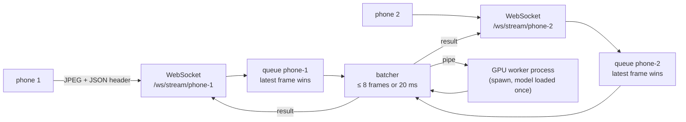

# Server and UI

One FastAPI process on `http://127.0.0.1:8000` takes frames from several phones at once, runs them on the GPU, exports Prometheus metrics at `/metrics` and serves a small web UI that summarises everything else (MLflow, Temporal, Grafana).

The code is in [`basir/api`](../basir/api/__init__.py).

## Run it

```bash
uv run python scripts/serve.py                         # http://127.0.0.1:8000
uv run python scripts/serve.py --host 0.0.0.0          # accept phones on the LAN
uv run python scripts/serve.py --port 8001
uv run python scripts/simulate_phones.py 2             # 2 phones replay fr1/desk at 15 fps for 30 s, then print stats
uv run python scripts/simulate_phones.py 4 --fps 30 --duration 60 --dataset fr1/room
uv run python scripts/simulate_phones.py 2 --dataset datasets/toy_room --fps 0   # as fast as possible
```

`serve.py` runs `basir.api.app:create_app` under uvicorn. On start-up the app spawns the GPU worker and waits until its model is loaded, then starts the batcher; on shutdown it stops both.

| `simulate_phones.py` option | Default | Does |
|---|---|---|
| `phones` | | Number of simulated phones |
| `--fps` | 15 | Frames per second per phone; 0 = as fast as possible |
| `--dataset` | `fr1/desk` | Preset key or dataset folder |
| `--duration` | 30 | Seconds to stream |
| `--max-frames` | 300 | Frames loaded and looped |
| `--url` | `ws://127.0.0.1:8000` | Server WebSocket base URL |

The simulator ([`phone_simulator.py`](../basir/api/phone_simulator.py)) encodes each frame the way a phone will send it (JPEG colour, pose, intrinsics), opens one WebSocket per phone, and prints per phone: frames sent and fps, results, dropped, errors, mean and max batch size, server latency p50 / p95 and round trip p50 / p95.

## Pages

| Page | Shows |
|---|---|
| **Live** (`/live`, also `/`) | Connected phones with frames/s, received, processed, dropped, queue depth, mean batch size, inference time and end-to-end latency (p50 / p95), plus the worker device and batching settings. Polls every 2 s. The same numbers are JSON at `/api/live` |
| **Pipelines** (`/pipelines`) | Temporal workflows (running first) with status, and the recent pipeline runs from MLflow, each with its DAG drawn from `dag.json` and every step coloured by `basir.status`. One link to the Temporal UI and one to the MLflow run. Polls every 5 s |
| **Experiments** (`/experiments`) | The MLflow layer: what is running now, the latest run of each experiment with pass / fail and 3 to 5 key metrics (consistency median, within 5 cm, fps, ...), and one link to the full run. Polls every 10 s |
| **Dashboards** (`/dashboards`) | Grafana panels and whole dashboards (host, GPU, Postgres, Temporal, server) embedded in kiosk mode, plus whether Grafana, Prometheus and Prometheus's scrape of this server are up. Panels are listed once in [`basir/api/grafana.py`](../basir/api/grafana.py) |

Every external service is optional: when one is down (or MLflow doesn't answer within 6 s), its section says *not reachable* and the rest of the page still works. The pages are server-rendered Jinja2 with [HTMX](https://htmx.org) (pinned, from a CDN) polling the live parts from `/partials/*`; the DAG is plain SVG drawn by the server, and there's a light and a dark theme.

## Multi-phone ingest



- **One small queue per phone, newest frame wins** ([`framebus.py`](../basir/api/framebus.py)). The queue holds `INGEST_QUEUE_SIZE` frames (default 2). When a phone sends faster than the GPU keeps up, the oldest waiting frame is dropped and counted (`basir_frames_dropped_total`). A late frame is worth less than a fresh one for guidance, so latency stays bounded instead of growing with a backlog.
- **One GPU worker, micro-batched across phones** ([`batcher.py`](../basir/api/batcher.py)). A batch closes at `BATCH_MAX_SIZE` frames (8) or `BATCH_MAX_WAIT_MS` (20 ms) after its first frame, whichever comes first, so frames from several phones share one GPU call. The batcher takes frames round-robin across phones, rotating who goes first, so no phone is always last. A failed batch is logged and skipped.
- **A separate GPU process** ([`worker.py`](../basir/api/worker.py)). The worker is started with `spawn`; torch is imported and the model loaded only there, once, with a warm-up call. The server process never initialises CUDA. Batches go over a pipe as lists of JPEG bytes, one batch in flight at a time.
- **Results go back on the same socket**, tagged with the phone's own `seq`.
- **Swappable.** The queues sit behind the `FrameBus` interface and the worker behind `InferenceBackend`, so Redis Streams or a second GPU can replace them without touching the WebSocket code.
- **Stub model until Phase 1.** `StubModel` decodes each JPEG, resizes it to 224x224 and runs one 3x3 convolution on the GPU (CPU if there is none), so the timings are realistic while perception isn't built yet.

## Wire protocol

Each phone holds one WebSocket at **`/ws/stream/{device_id}`**. The format is defined in [`basir/api/protocol.py`](../basir/api/protocol.py).

**Device IDs** are 1 to 64 characters of `A-Z a-z 0-9 . _ -`. An invalid ID, or one that's already connected, is closed with code **1008** (policy violation).

**Phone → server:** one **binary** message per frame.

```text
+-----------------------------+---------------------------+------------------+
| header length (uint32,      | JSON header (UTF-8)       | JPEG bytes       |
| big-endian)                 |                           | (colour image)   |
+-----------------------------+---------------------------+------------------+
```

| Header field | Required | Meaning |
|---|---|---|
| `seq` | yes | Per-phone frame counter |
| `timestamp` | yes | Sensor time in seconds |
| `pose` | no | `T_world_cam` as 16 numbers, row-major 4x4 (see [Geometry](02-geometry.md)) |
| `intrinsics` | no | `{"fx", "fy", "cx", "cy", "width", "height"}` |

**Server → phone:** one **text** message (JSON) per processed frame.

```json
{"device": "phone-1", "seq": 17, "batch_size": 3, "queue_ms": 4.1,
 "inference_ms": 6.3, "latency_ms": 12.0, "dropped": 2}
```

| Field | Meaning |
|---|---|
| `queue_ms` | Receipt on the server → batch sent to the worker |
| `inference_ms` | The whole batch inside the worker |
| `latency_ms` | Receipt on the server → result ready |
| `dropped` | How many of this phone's frames were replaced by newer ones so far |

A malformed message (not binary, bad header, payload not a JPEG) is answered with `{"error": "..."}` and the connection stays open.

## Metrics

All metrics have the prefix `basir_`, are served at `/metrics`, scraped by Prometheus every 5 s and shown on Grafana's *Basir server* dashboard. **The names are a contract with that dashboard; don't rename them.**

| Metric | Type | Labels | Meaning |
|---|---|---|---|
| `basir_http_requests_total` | counter | `method`, `path`, `status` | HTTP requests; `path` is the route template, not the raw path |
| `basir_http_request_seconds` | histogram | | HTTP request duration |
| `basir_ws_connections` | gauge | | Phones connected |
| `basir_frames_received_total` | counter | `device` | Frames received |
| `basir_frames_dropped_total` | counter | `device` | Frames replaced by a newer one before inference |
| `basir_queue_depth` | gauge | `device` | Frames waiting for inference |
| `basir_batch_size` | histogram | | Frames per GPU batch |
| `basir_inference_seconds` | histogram | | GPU worker time per batch |
| `basir_frame_latency_seconds` | histogram | | Frame receipt to result |

**Request IDs.** Every HTTP request and WebSocket connection gets an `X-Request-ID`, echoed in the response (or WebSocket accept) headers. A client-supplied ID is kept when it's 1 to 128 printable characters; otherwise a new one is generated.

## Modules

| Module | Holds |
|---|---|
| `app` | App factory; the lifespan starts the GPU worker and batcher |
| `protocol` | The wire format |
| `framebus` | Per-phone latest-frame-wins queues (`FrameBus`, `InProcessFrameBus`) |
| `batcher` | Micro-batching across phones and result routing |
| `worker` | The spawned GPU process (`InferenceBackend`, `ProcessBackend`) and `StubModel` |
| `devices` | Connected phones and their rolling statistics |
| `ingest` | The `/ws/stream/{device_id}` endpoint |
| `metrics` | Metric definitions, HTTP timing and `/metrics` |
| `middleware` | Request IDs |
| `mlflow_view`, `temporal_view` | Read-only summaries of MLflow runs and Temporal workflows for the UI |
| `dag` | `dag.json` parsing and SVG layout |
| `services`, `grafana` | Grafana / Prometheus reachability, and which panels are embedded |
| `phone_simulator` | Simulated phones replaying a dataset over WebSocket |
| `ui` | Pages and HTMX fragments |

Why frames go through asyncio queues rather than a task queue is explained in [Async processing](10-async-processing.md).
