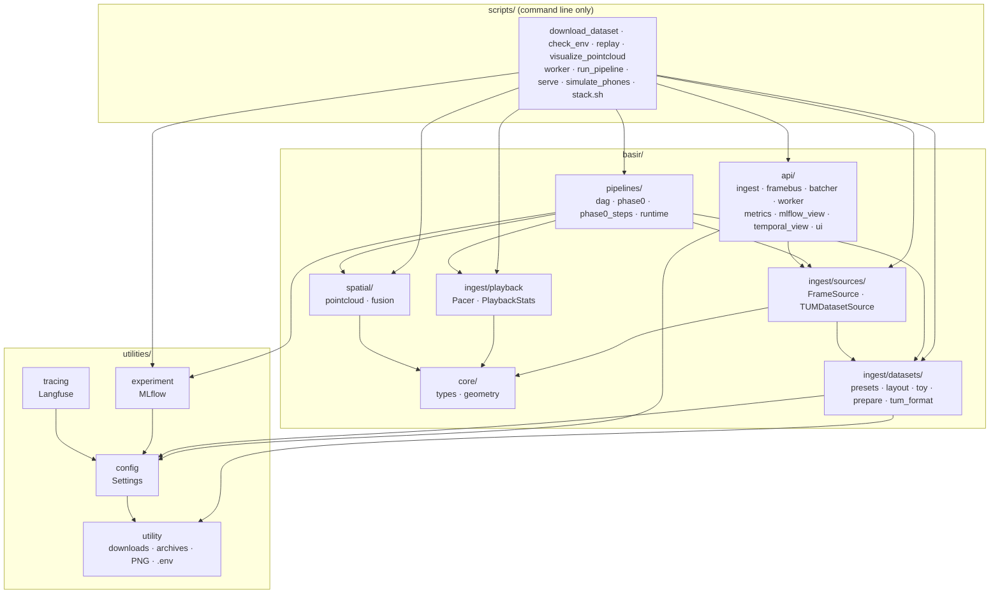

# Architecture and project structure

How the code is split, and the rules that keep it that way. The full UML (user stories, use cases, sequence and class diagrams) lives on [the `software_engineering` branch](https://github.com/omarTBakr/Basir/tree/software_engineering/software_engineering).

## Modules



## Rules

- **Scripts are thin.** Each one parses arguments, calls `basir/`, and logs to MLflow. No script imports another script, so everything reusable lives in the library.
- **One job per module.** Dataset preparation is split into the catalogue (`presets`), the index files (`layout`), the synthetic test data (`toy`), the file formats (`tum_format`) and the download pipeline (`prepare`). Playback pacing is separate from any display, and map building (`spatial/pointcloud`) is separate from the viewer.
- **Frame sources are interchangeable.** Anything that yields `Frame`s satisfies [`FrameSource`](../basir/ingest/sources/base.py): the TUM dataset today, phone recordings and the live ARCore stream later.
- **Geometry has no I/O.** [`basir/core`](../basir/core/types.py) depends on numpy only, so it's fast to test and safe to reuse in every phase.
- **The server is one process plus one GPU worker.** [`basir/api`](../basir/api/__init__.py) holds the FastAPI app: phone ingest, micro-batching, the spawned GPU worker, Prometheus metrics and the UI ([Server and UI](09-server-and-ui.md)).
- **Pipelines keep I/O in activities.** Workflow code stays deterministic; activities do the work and the logging ([Pipelines](07-pipelines.md)).
- **Scripts never import MLflow or Langfuse directly.** They go through [`utilities/experiment.py`](../utilities/experiment.py) and [`utilities/tracing.py`](../utilities/tracing.py). Logging failures produce one warning and never stop a run.
- **`utilities/` is generic, `basir/` is the domain.** Settings, run tracking, tracing and helpers (URLs, hashing, archives, downloads, PNG writing, `.env` parsing) know nothing about Basir's domain.

## Project structure

```text
Basir/
├── basir/
│   ├── core/
│   │   ├── types.py                # Frame, Pose, CameraIntrinsics
│   │   └── geometry.py             # rotations, transforms, projection, depth → points, consistency
│   ├── ingest/
│   │   ├── datasets/
│   │   │   ├── presets.py          # the TUM RGB-D catalogue and name resolution
│   │   │   ├── layout.py           # associations.txt and dataset_meta.json
│   │   │   ├── toy.py              # synthetic dataset with known geometry (tests)
│   │   │   ├── prepare.py          # resolve, download, extract, index a dataset
│   │   │   └── tum_format.py       # TUM file formats + per-sensor calibration (stdlib only)
│   │   ├── sources/
│   │   │   ├── base.py             # FrameSource interface
│   │   │   └── tum.py              # TUMDatasetSource
│   │   └── playback.py             # real-time pacing and playback statistics
│   ├── spatial/
│   │   ├── pointcloud.py           # fused cloud, consistency score, top-down image
│   │   └── fusion.py               # the Phase 0 check: fuse, score against the targets, save outputs
│   ├── pipelines/
│   │   ├── dag.py                  # steps + dependencies, as dag.json / Mermaid
│   │   ├── phase0.py               # Phase0Pipeline Temporal workflow and its DAG
│   │   ├── phase0_steps.py         # its activities, each logged as a nested MLflow run
│   │   └── runtime.py              # Temporal client, worker, task queue, UI links
│   └── api/                        # the server: phone ingest, GPU worker, metrics, web UI
│       ├── app.py                  # app factory; lifespan starts the GPU worker and batcher
│       ├── protocol.py             # wire format: JPEG + JSON header in, JSON result out
│       ├── framebus.py             # per-phone latest-frame-wins queues (FrameBus interface)
│       ├── batcher.py              # micro-batching across phones, result routing
│       ├── worker.py               # spawned GPU process (InferenceBackend) + stub model
│       ├── devices.py              # connected phones and their rolling stats
│       ├── ingest.py               # /ws/stream/{device_id}
│       ├── metrics.py              # Prometheus metrics, HTTP timing, /metrics
│       ├── middleware.py           # request IDs (HTTP + WebSocket)
│       ├── mlflow_view.py          # MLflow layer: running, latest per experiment, pipelines
│       ├── temporal_view.py        # running / recent Temporal workflows
│       ├── dag.py                  # dag.json parsing and SVG layout
│       ├── services.py             # Grafana / Prometheus reachability
│       ├── grafana.py              # which dashboards and panels are embedded
│       ├── phone_simulator.py      # phones replaying a dataset over WebSocket
│       ├── ui.py                   # pages and HTMX fragments
│       ├── templates/              # Jinja2 (Live, Pipelines, Experiments, Dashboards)
│       └── static/style.css        # light / dark theme
├── utilities/
│   ├── config.py                   # Settings (env file + environment)
│   ├── environment.py              # installed package versions
│   ├── experiment.py               # MLflow run tracking (incl. parent / nested runs)
│   ├── tracing.py                  # Langfuse tracing (no-op without keys)
│   └── utility.py                  # URLs, hashing, archives, downloads, PNG, .env parsing
├── scripts/                        # command line only
│   ├── download_dataset.py         # get a preset / URL / archive ready on disk
│   ├── check_env.py                # versions, CUDA, paths, Langfuse smoke trace
│   ├── replay.py                   # real-time RGB-D playback window
│   ├── visualize_pointcloud.py     # the Phase 0 check
│   ├── worker.py                   # Temporal worker for the pipelines
│   ├── run_pipeline.py             # start a pipeline (phase0) and print its links
│   ├── serve.py                    # run the server on :8000
│   ├── simulate_phones.py          # N simulated phones streaming a dataset
│   └── stack.sh                    # local stack: up / down / status / logs
├── Docker/                         # the local stack: docker-compose.yml + one folder per service
├── env/                            # .env.example and stack.env.example (the real files are git-ignored)
├── docs/                           # this documentation
├── tests/                          # one test file per module + shared fixtures
├── logo/                           # logo (scan + chat) and README image, light / dark SVG + PNG
│   └── src/                        # generators that rebuild them from the Phase 0 scan
├── datasets/                       # downloaded sequences (git-ignored)
│   └── *.dvc                       # DVC pointers to the tracked sequences
├── .dvc/                           # DVC config (remote) and local cache
├── outputs/                        # point clouds and images (git-ignored)
├── mlartifacts/                    # MLflow artifacts (git-ignored)
└── pyproject.toml                  # dependencies (uv), pytest and ruff config
```

The logo and README image are built from the room Basir reconstructed in Phase 0; [`logo/src/README.md`](../logo/src/README.md) explains how to rebuild them.
